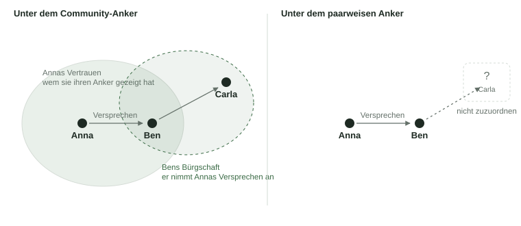

# Das Modell im RLTP

Wie Versprechen, Bestätigung, Bürgschaft und Kreise auf das Real Life Trust Protocol fallen. Was es schon trägt, was zu gießen ist, und warum ein Versprechen genau so weit wandert wie das Vertrauen dessen, der es gibt.

English: [rltp.md](rltp.md) · Modell: [model.de.md](../model.de.md)

## Zuordnung

| Modell | RLTP heute | Zu gießen |
|---|---|---|
| Mensch | Identität mit einem Anker je Kontext: paarweise je Beziehung, je Gruppe, und der Community-Anker als eigener stabiler Koordinat. Begegnung: zwei Menschen bestätigen, dass sie sich erkannt haben. Anker-Mapping: ich zeige dir, dass zwei meiner Anker zu mir gehören. | nichts |
| Versprechen | kein Credential. Jede RLTP-Nachricht ist ein Trust Task; der Lebenslauf eines Versprechens (geben, übertragen, einlösen) ist eine Folge von Trust Tasks. | das Credential und die Task-Typen, siehe Naht [Versprechen](../seams/promise.de.md) |
| Bestätigung | Gen 2: Attestation, live. Gen 3: nicht gegossen. DTG bietet dafür das Endorsement Credential. | der Attestations-Guss: an welchen Anker, wie portabel |
| Bürgschaft | nicht vorhanden. `vouch@2` ist an eine Aufnahme gebunden, `introduction-voucher` ist ein Artefakt beim Vorstellen. | ein neuer Typ: stehende, widerrufbare Erklärung „ich nehme deine Versprechen an“ |
| Vertrauen | der Trust-Akt: Mapping offenlegen, Aufnahme in den Stern des anderen. | nichts, aber eine zweite Bedeutung, siehe unten |
| Kreis | Access-Gruppe: verschlüsselter Ort, Regeln als Daten, keine Admins, Mitgliedschaft = Schlüssel. | nichts |
| Zweckgebundenes Versprechen | Inhalt im Gruppenraum, sichtbar für Mitglieder, wie heute Kandidatur-Inhalte. | ein Inhaltstyp |

## Warum ein Versprechen den Community-Anker braucht

Ein liquides Versprechen wird weitergegeben. Wer es annimmt, muss zwei Dinge können: erkennen, wer es gegeben hat, und sehen, was dieser Mensch bisher gehalten hat. Beides hängt an einer Identität. Welche, entscheidet, wie weit das Versprechen kommt.

Anna kennt Ben und Carla. Zu jedem hat sie einen eigenen paarweisen Anker, den nur die beiden kennen. Dazu hat sie einen Community-Anker: ihren einen stabilen Koordinat, den sie denen offenlegt, denen sie vertraut.

**Versprechen unter dem paarweisen Anker.** Anna gibt Ben ein Versprechen, signiert mit dem Anker, den nur Ben kennt. Ben gibt es an Carla weiter. Carla sieht eine Signatur, die sie keinem Menschen zuordnen kann, und keine Bestätigungen dazu. Das Versprechen ist bei Ben zu Ende.

**Versprechen unter dem Community-Anker.** Anna gibt Ben dasselbe Versprechen, signiert mit ihrem Community-Anker. Ben gibt es an Carla weiter. Hat Anna Carla den Anker offengelegt, erkennt Carla Anna und sieht ihre Bestätigungen. Hat sie es nicht, hilft Bens Bürgschaft: Ben nimmt Annas Versprechen an, Carla kennt Ben, also nimmt Carla es von Ben.

> Ein Versprechen wandert genau so weit, wie der, der es gibt, sein Vertrauen offengelegt hat, erweitert um die, die für ihn bürgen.

Liquidität ist damit keine Eigenschaft des Versprechens, sondern des Vertrauensnetzes um den, der es gibt. Es gibt keinen Markt, auf dem ein Versprechen zu Fremden gelangt. Wer niemandem sein Mapping zeigt, hat Versprechen, die niemand weitergeben kann. Und der Trust-Akt bekommt neben dem Stern eine zweite Bedeutung: Er öffnet den Weg für die eigenen Versprechen.

Für den Guss folgt daraus: Das Versprechen-Credential hat als Aussteller den Community-Anker. Bestätigungen und Bürgschaften hängen am selben Anker. Bestätigungen, die in einem Gruppenkontext entstehen, müssen beim Vorzeigen auf diesen Anker abgebildet werden können; das ist die offene Frage der Portabilität in der Visibility-Spec, und sie hat hier ihren Zweck.

## Bürgschaft als Rücknahme, nicht als Wechselkurs

Circles kennt denselben Gedanken: Jeder prägt eigene Einheiten, und ein Vertrauenspfad heißt „ich nehme deine wie meine“. Zahlungen laufen entlang der Pfade, weil unterwegs getauscht wird: B gibt C nicht As Einheiten, sondern seine eigenen. Das geht, weil alle Einheiten gleich sind.

Hier ist ein Versprechen „50 Brote bis Juni“. B kann C dafür kein eigenes Versprechen geben, das C braucht. Also wandert dasselbe Versprechen weiter, und die Bürgschaft leistet etwas anderes als bei Circles: Sie ist keine Umrechnung, sondern eine Rücknahme. C nimmt Annas Versprechen, weil Ben es jederzeit abnimmt. Die Bürgschaft gibt dem Versprechen einen sicheren nächsten Schritt. Das macht es liquide, obwohl es keine einheitlichen Einheiten gibt.

Daraus folgt die Form des Typs: Eine Bürgschaft ist eine stehende Erklärung von B über A, signiert von B, widerrufbar, mit optionaler Grenze. Sie liegt bei B und wird dem gezeigt, der Annas Versprechen annehmen soll. Sie ist kein Credential über A, das A hält, sondern ein Angebot von B.

## Drei Akte in einer Beziehung

Das RLTP kennt zwei Akte zwischen Menschen: **Erkennen** (die Begegnung: zwei Menschen bestätigen, dass sie sich getroffen haben) und **Vertrauen** (ich zeige dir meinen Kontext, du darfst mich in deinen Stern aufnehmen). Die Bürgschaft ist der dritte: **Einstehen** (ich nehme deine Versprechen an). Jeder ist freiwillig, einseitig und hat eine eigene Folge. Erkennen macht dich sichtbar, Vertrauen macht deine Versprechen weitergebbar, Einstehen macht sie annehmbar für Menschen, die dich nicht kennen.

## Kreise

Ein Kreis ist eine Access-Gruppe: ein verschlüsselter Ort mit Regeln, die seine Mitglieder als Daten setzen. Zweckgebundene Versprechen sind Inhalt in diesem Ort. Wer sie geben will, muss den Schlüssel halten, also Mitglied sein, und Mitglied wird man durch Einladung und Aufnahme nach den Regeln des Kreises.

Liquide Versprechen brauchen den Ort nicht. Wer mit einem Kreis handelt, handelt mit Menschen aus dem Kreis, unter ihren Community-Ankern. Daraus folgt, dass zwei bisher offene Punkte der Access-Spec keinen Zweck mehr haben: Credentials, die eine Gruppe nach außen ausstellt, und Rechte für Nicht-Mitglieder. Kreise sprechen nicht, und wer draußen ist, handelt liquide.

## Zu gießen

1. **Bestätigung.** Ein Credential von Mensch an Mensch: hat geliefert, war zuverlässig, danke, mit optionalem Bezug auf ein Versprechen. Aussteller und Subjekt unter Community-Ankern, wo das Mapping besteht; sonst unter dem Gruppenanker mit Abbildung beim Vorzeigen. Gehalten vom Bestätigten. Nie widerrufen.
2. **Bürgschaft.** Eine stehende Erklärung „ich nehme die Versprechen von A an“, mit optionaler Grenze, widerrufbar. Gehalten vom Bürgen, gezeigt dem, der annehmen soll. Ein Credential, dessen Halter der Aussteller ist.
3. **Versprechen.** Ein Credential (der Gutschein) und die Trust Tasks, die es bewegen: geben, übertragen, einlösen, verfallen. Aussteller unter dem Community-Anker. Form, Log und doppelte Weitergabe: Naht [Versprechen](../seams/promise.de.md), gemeinsam mit Human Money Core.

Alles andere ist vorhanden: Identität, Begegnung, Mapping, Stern, Gruppen, Zustellung.

## Quellen

- [Real Life Trust Protocol](https://trust-protocol.real-life.org): Identity, Encounter, Access, Membership Tasks, Network Visibility
- [Human Money Core](https://github.com/minutogit/human-money-core)
- [DTG Credentials](https://github.com/trustoverip/dtgwg-cred-tf) (Endorsement Credential)
- [Circles](https://joincircles.net/)
